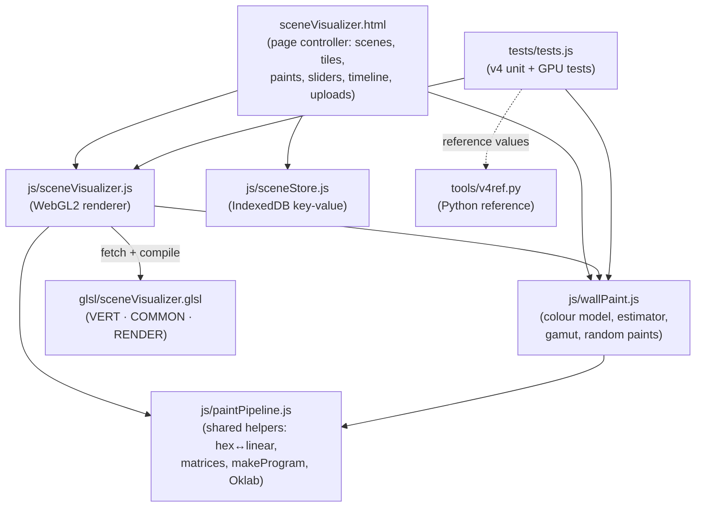
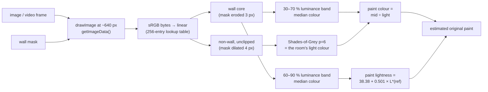

# How sceneVisualizer works: a code guide for JavaScript developers

This guide explains the code behind `sceneVisualizer.html`. It assumes you
are comfortable with modern JavaScript and the DOM, and that you have
**never written a GLSL shader**. It covers:

1. What the page does, as one picture
2. A GLSL primer for JavaScript developers
3. The files and how they depend on each other
4. The life of one frame
5. The shader, line by line
6. The colour model on the JavaScript side (`js/wallPaint.js`)
7. The WebGL renderer (`js/sceneVisualizer.js`)
8. Estimating the original wall colour, on the CPU
9. Random test paints and the paint gamut
10. The page controller (`sceneVisualizer.html`)
11. Testing and debugging
12. Gotchas and how to extend it

The colour science behind the design (why CAT16, why a bounce term, the
measurements) is in `docs/scene-visualizer.md` and
`docs/scene-visualizer-plan.md`. This guide is about the *code*.

---

## 1. What the page does, as one picture

The page shows a room photo or video with its walls repainted. Three things
make that possible:

1. A **wall mask** (from an external segmentation model): black where the
   walls are, white everywhere else.
2. A **GPU shader** that repaints *every* pixel as if it were wall, in well
   under a millisecond.
3. **A CSS trick:** the original image is laid on top of the repainted one,
   with the mask as a CSS `mask-image`. The original covers everything
   except the walls, so only the walls show the new paint.

```
          what you see
               ▲
   ┌───────────┴─────────────────────────────┐
   │   / <canvas class="top">           │  original image, CSS-masked:
   │  mask-image: url(mask.png)              │  visible where the mask is white
   │  mask-mode: luminance                   │  (not wall), transparent on walls
   ├─────────────────────────────────────────┤
   │  <canvas class="tinted">                │  the shader's output: the WHOLE
   │  (2-D canvas, copied from WebGL)        │  image repainted as if it were wall
   └─────────────────────────────────────────┘
```

This split keeps the shader simple. It never needs to know where the walls
are, and the non-wall pixels are untouched because the browser shows the
original file for them.

The shader can't just paint the walls a flat colour, because that would
erase the room's lighting. Instead, for every pixel it:

1. **Divides out the original paint.** What's left is the light falling on
   that spot: brightness, colour cast, shadow, sun patch. We call this the
   **Wall Colour Delta**.
2. **Multiplies the new paint by that light.**

```
   photo pixel  ÷  original paint  =  the light at this pixel (the "delta")
   the light    ×  new paint       =  the repainted pixel
```

The rest of the code makes that formula correct (colour spaces), fast (the
GPU), and usable (estimation, UI).

---

## 2. A GLSL primer for JavaScript developers

### 2.1 The mental model: a pure function run once per pixel

A *fragment shader* is a function the GPU runs **once for every pixel** of
the output, thousands at a time in parallel. In JavaScript terms:

```js
// What the GPU effectively does (but massively parallel, and in C-like GLSL):
for (const pixel of canvas) {
  pixel.color = main(pixel.x, pixel.y, uniforms, textures);
}
```

Some consequences surprise JavaScript developers:

| Rule | Why |
|---|---|
| A pixel can't see what other pixels computed in the same pass. | They all run at once. A pixel can only *read* input textures. |
| No `return` value; you assign an output variable instead. | Here it is `out vec4 fragOut;`. |
| No `console.log`. | You debug by writing colours to the output (see §11). |
| No dynamic memory, strings, objects or recursion. | Only numbers, vectors, matrices and fixed-size arrays. |
| Inputs are the same for every pixel. | *Uniforms* are like function parameters shared by all pixels for one draw. |

### 2.2 Types and syntax, mapped to JavaScript

GLSL ES 3.00 (the WebGL2 dialect) is a small, statically typed C-like
language.

| GLSL | Rough JavaScript equivalent | Notes |
|---|---|---|
| `float x = 1.0;` | `let x = 1;` | Floats need the `.0`: `1` is an `int`, and ints and floats don't mix. |
| `int i = 3;` | `let i = 3 \| 0;` | |
| `vec3 c = vec3(0.2, 0.5, 1.0);` | `[0.2, 0.5, 1.0]` | Also `vec2`, `vec4`. |
| `c.r`, `c.g`, `c.b` (or `c.x, c.y, c.z`) | `c[0]`, `c[1]`, `c[2]` | |
| `c.yz` | `[c[1], c[2]]` | "Swizzling": any combination, e.g. `c.bgr`. |
| `c * 2.0`, `c + d`, `c * d` | `c.map(...)` | Arithmetic is component-wise on vectors. |
| `mat3 m; m * v` | `mat.apply(m, v)` | A real matrix × vector product. |
| `const float K = 0.4;` | `const K = 0.4;` | |
| `uniform vec3 gain;` | a parameter set from JS | Same value for every pixel in one draw. |
| `uniform sampler2D src;` | an image handle | Read with `texture()` or `texelFetch()`. |
| `out vec4 fragOut;` | the return value | What this pixel becomes (RGBA, 0..1). |

The built-in functions all work per component on vectors:

| Function | Meaning |
|---|---|
| `mix(a, b, t)` | `a + (b - a) * t`, a lerp |
| `clamp(x, lo, hi)` | Clamp to a range |
| `step(edge, x)` | `x < edge ? 0 : 1` |
| `pow`, `exp`, `exp2`, `sqrt`, `abs`, `sign`, `max`, `min` | As in `Math` |
| `dot(a, b)`, `length(v)`, `distance(a, b)` | Vector maths |
| `fract(x)` | `x - Math.floor(x)` |

Two GLSL ideas need special care:

* **`gl_FragCoord`** is the built-in "which pixel am I". `gl_FragCoord.xy` is
  the pixel's centre in canvas pixels, `(0.5, 0.5)` at the **bottom-left**.
  Images, by contrast, are stored top row first. That flip appears in our
  `main()`.
* **Matrices are column-major.** `mat3(a, b, c, d, e, f, g, h, i)` fills
  *columns* first. Our JS keeps 3×3 matrices row-major (as you'd write them
  on paper), so `mat.toGL()` transposes them before upload. Forget this and
  your colours come out subtly wrong, not obviously broken.

### 2.3 Precision

```glsl
precision highp float;
```

GPUs can compute at lower precision (`mediump`) for speed. Colour maths with
matrices and cube roots shows visible banding at `mediump`, so every shader
here declares `highp`.

### 2.4 Branches and loops

`if` and `for` exist, but neighbouring pixels execute in lock-step groups. If
they take different branches, the GPU may run *both* sides. Our shader
branches only on **uniforms** (`if (sliders == 0)`), which have the same
value for every pixel, so the branch is free. The one loop
(`for (int i = 0; i < 16; i++)` in gamut mapping) has a fixed count, which
GLSL ES requires.

### 2.5 Vertex shaders, briefly

WebGL draws triangles. A **vertex shader** places the corners, and the
**fragment shader** colours every pixel inside them. We just want "every
pixel of the canvas", so the vertex shader produces one huge triangle that
covers the screen (§5.1). If you only ever touch one shader in this project,
it will be the fragment shader.

---

## 3. The files and how they depend on each other



All scripts are **classic scripts**, not ES modules. Each wraps itself in an
IIFE and exports one global (`window.WallPaint`, `window.SceneVisualizer`).
They load in dependency order through `<script>` tags. The page's own logic
is a `<script type="module">` at the bottom of the HTML, so it can use
top-level `await`.

| File | Approx. lines | Role |
|---|---|---|
| `glsl/sceneVisualizer.glsl` | 130 | The GPU code: one fragment program |
| `js/sceneVisualizer.js` | 150 | Creates the WebGL context, uploads images, sets uniforms, draws |
| `js/wallPaint.js` | 400 | The colour model in JS, the original-paint estimator, the paint gamut, random paints |
| `sceneVisualizer.html` | 600 | Layout, CSS layering, all UI state and events |
| `js/paintPipeline.js` | (shared) | Older module; we reuse its small helpers only |

---

## 4. The life of one frame

Here is everything that happens when you click a paint chip while a photo
scene is showing:

```mermaid
sequenceDiagram
  participant U as User
  participant P as Page (sceneVisualizer.html)
  participant W as WallPaint (JS)
  participant R as Renderer (JS)
  participant G as GPU (shader)
  participant C as Tile <canvas> 2-D

  U->>P: click chip "#5a6b8c"
  P->>P: setPaint(hex) → redraw()
  loop for each tile (morning, noon, night)
    P->>R: draw(look(tile), tile.key)
    R->>W: transfer(oldLin, newLin) → { old16, gain }
    R->>G: bind texture, set uniforms, drawArrays(3 vertices)
    G-->>R: every pixel: photo × gain → gamut map → sRGB
    P->>C: tile.out.drawImage(renderer.canvas)
  end
  Note over C: CSS-masked original sits on top;<br/>only wall pixels show the new canvas
```

For a **video**, the trigger is the browser's
`video.requestVideoFrameCallback`, which fires once per *new* decoded
frame. The callback uploads the frame to the GPU, draws, and in the same
callback copies the untouched frame into the masked top canvas. Both layers
change on the same frame, so the wall edges never shimmer.

---

## 5. The shader, line by line (`glsl/sceneVisualizer.glsl`)

The file is split into sections by marker comments (`//@@VERT`,
`//@@COMMON`, `//@@RENDER`). The renderer cuts it at those lines (§7.1) and
builds:

```
vertex shader   = VERT
fragment shader = COMMON + "\n" + RENDER
```

Keeping everything in one file means one fetch, and the helpers live next to
the code that uses them.

### 5.1 VERT: one triangle that covers the screen

```glsl
//@@VERT
#version 300 es
void main() {
  vec2 p = vec2(gl_VertexID == 1 ? 3.0 : -1.0, gl_VertexID == 2 ? 3.0 : -1.0);
  gl_Position = vec4(p, 0.0, 1.0);
}
```

There is no vertex buffer at all. `drawArrays(TRIANGLES, 0, 3)` runs this
three times with `gl_VertexID` = 0, 1, 2, which produces the corners
(−1,−1), (3,−1) and (−1,3) in "clip space", where the visible screen is
the square from −1 to 1:

```
 (−1,3)
   ●
   │ \
   │   \
   ├─────┐ \            the visible square (−1..1) sits inside
   │screen│   \         the triangle; the GPU clips the rest
   │      │     \
   ●──────┴──────●
 (−1,−1)      (3,−1)
```

One triangle has no diagonal seam (two triangles would share an edge) and
needs no buffers.

### 5.2 COMMON: the prelude and colour helpers

```glsl
//@@COMMON
#version 300 es
precision highp float;
precision highp int;
precision highp sampler2D;
out vec4 fragOut;
```

`#version 300 es` must be the **very first line** of a shader. That is why
VERT and COMMON each start with it, and why RENDER (appended after COMMON)
must not.

Two kinds of helper follow:

```glsl
// linear light -> sRGB-encoded values for the screen (IEC 61966-2-1)
vec3 toSRGB(vec3 c) {
  c = max(c, 0.0);
  return mix(12.92 * c, 1.055 * pow(c, vec3(1.0 / 2.4)) - 0.055, step(0.0031308, c));
}
float lum(vec3 c) { return dot(c, vec3(0.2126729, 0.7151522, 0.0721750)); }
```

`toSRGB` shows a common GLSL idiom: **branch-free selection**.
`step(edge, c)` is 0 or 1 per channel, and `mix(a, b, 0|1)` picks `a` or `b`.
It's the GLSL way to write `c <= edge ? a : b` for all three channels at
once, with no `if`.

`oklab()` and `oklabToRGB()` convert to and from the **Oklab** colour space,
where distances and "how colourful" roughly match perception. The gamut
mapping and the Saturation slider use it.

### 5.3 RENDER: the inputs (uniforms)

```glsl
uniform sampler2D src;              // the photo / video frame
uniform mat3  to16, from16, toOutput;
uniform vec3  old16, gain;
uniform int   sliders, dither;
uniform float contrastK, pivotY, satAmount, medianChroma;
```

| Uniform | Set from JS as | Meaning |
|---|---|---|
| `src` | texture unit 0 | The image, uploaded as an **sRGB texture** (see below) |
| `to16`, `from16` | `WallPaint.TO16` / `FROM16` | Linear sRGB ↔ CAT16 cone space |
| `toOutput` | identity or `SRGB_TO_P3` | Converts to the display's primaries |
| `old16` | from `transfer()` | The original paint in CAT16 |
| `gain` | from `transfer()` | Everything that turns old light into new, per channel |
| `sliders` | 0 or 1 | Whether Contrast/Saturation are off-centre |
| `contrastK`, `satAmount`, `pivotY`, `medianChroma` | slider state + stats | The slider maths |
| `dither` | 1 (tests use 0) | Adds ±½ of an 8-bit step of noise |

**Why "sRGB texture" matters.** Image files store *gamma-encoded* values,
squeezed so they look even to the eye. Light, however, adds and multiplies
in *linear* units. The renderer uploads with the internal format
`SRGB8_ALPHA8`, which tells the GPU "these bytes are sRGB-encoded". Every
read then returns **linear** light for free, with no decode code in the
shader.

### 5.4 RENDER: `main()`

```glsl
void main() {
  ivec2 size = textureSize(src, 0);
  ivec2 p = ivec2(gl_FragCoord.x, float(size.y) - gl_FragCoord.y);   // rows top-down as uploaded
  vec3 photo16 = to16 * texelFetch(src, p, 0).rgb;
  vec3 c16;
  if (sliders == 0) {
    c16 = photo16 * gain;
  } else {
    vec3 light = adjustLight(from16 * (photo16 / old16));
    c16 = (to16 * light) * old16 * gain;
  }
  vec3 c = compress(from16 * c16);
  vec3 enc = toSRGB(clamp(toOutput * c, 0.0, 1.0));
  if (dither == 1) enc += (hash(gl_FragCoord.xy) - 0.5) / 255.0;
  fragOut = vec4(enc, 1.0);
}
```

Step by step:

1. **Which source pixel.** `texelFetch(src, p, 0)` reads exactly one texel at
   integer coordinates. No filtering is needed, because the canvas is the
   same size as the source. The row flip turns the bottom-up `gl_FragCoord`
   into the top-down image row.
2. **Into CAT16 space.** `to16 * colour` is a 3×3 matrix multiply. CAT16 is
   a "sharpened cone" space: its three channels behave like the eye's
   cones, but narrower. In such a space a change of light is almost exactly
   a *per-channel multiplication*, which is the operation we're about to do.
   (In plain RGB, and even more in XYZ, that assumption breaks down.)
3. **The core formula, slider-free path.** `c16 = photo16 * gain`, one
   component-wise multiply. All the physics is folded into `gain` on the CPU
   (§6.2):

   ```
   gain = new16 · G(new16) / (old16 · G(old16))
   ```

   So the per-pixel work is a matrix, a multiply and another matrix.
4. **Slider path.** When Contrast or Saturation is off-centre, the shader
   first computes the light explicitly (`photo16 / old16`, the Wall Colour
   Delta). It adjusts the light in Oklab (`adjustLight`, below), then
   applies the paint. With both sliders at 0 the two paths give the same
   result, but the first one is exact and cheaper.
5. **Back to linear sRGB, then gamut mapping.** `compress()` makes sure the
   colour can be displayed (§5.5).
6. **To the display.** `toOutput` converts to Display P3 when the browser
   and screen support it. `toSRGB` encodes, and a tiny per-pixel random
   offset (**dither**) prevents banding in smooth wall gradients.
7. **Write the pixel.** `fragOut = vec4(enc, 1.0)`; alpha is opaque.

```
 texel ─► linear (free, sRGB texture) ─► ×to16 ─► ×gain ─► ×from16 ─► compress ─► ×toOutput ─► toSRGB ─► +dither ─► fragOut
                                           │                    ▲
                                           └─(sliders on)─ ÷old16 → adjustLight() → ×old16 ┘
```

**`adjustLight()`** works on the *light*, not the paint:

```glsl
vec3 adjustLight(vec3 d) {
  vec3 l = oklab(max(d, 0.0));
  float r = clamp(length(l.yz) / max(medianChroma, 1e-4), 0.0, 3.0);
  l.yz *= exp2(satAmount * r);                       // saturation: scale the chroma
  d = max(oklabToRGB(l), 0.0);
  float Y = lum(d);
  if (Y > 1e-6) d *= pow(Y / max(pivotY, 1e-4), contrastK - 1.0);   // contrast around the median
  return d;
}
```

`l.yz` is the Oklab chroma (a and b). Saturation scales it more for strongly
coloured light and not at all for neutral light. Contrast is an exponent on
luminance around the wall's median light (`pivotY`): it stretches or
flattens the room's light and shadow.

### 5.5 `compress()`: gamut mapping without hue shifts

Repainting a white wall white in bright sunlight, or a grey wall a vivid
orange, can produce colours brighter or more saturated than the screen can
show. Clamping each channel to 0..1 would shift the hue (an over-bright
orange turns yellow). `compress()` instead:

1. **Returns displayable colours unchanged** (`if (inGamut(c)) return c;`).
2. **Too bright:** scales the colour down to fit, then *bleaches* it toward
   white the way over-exposed film does:
   `t = 1 − exp(−0.7·(m − 1))`, where `m` is how far over the limit it is.
3. **Still out of gamut:** binary-searches a chroma scale at fixed lightness
   and hue, with 16 halvings (precision 1/65536):

```glsl
float lo = 0.0, hi = 1.0;
for (int i = 0; i < 16; i++) {
  float mid = 0.5 * (lo + hi);
  if (inGamut(oklabToRGB(vec3(lab.x, lab.yz * mid)))) lo = mid; else hi = mid;
}
```

The loop is fine on a GPU because its count is constant.

---

## 6. The colour model on the JavaScript side (`js/wallPaint.js`)

The shader is deliberately dumb. All decisions are made once per draw in JS
and passed down as uniforms.

### 6.1 Building the CAT16 matrix

```js
const TO16 = (() => {
  const m = mat.mul(CAT16, RGB2XYZ);                    // linear sRGB -> XYZ -> CAT16
  const w = mat.apply(m, [1, 1, 1]);
  return m.map((v, k) => v / w[Math.floor(k / 3)]);     // scale rows so white -> (1,1,1)
})();
const FROM16 = mat.inverse(TO16);
```

Matrices in `paintPipeline.js` are flat 9-element arrays in **row-major**
order: `[r0c0, r0c1, r0c2, r1c0, …]`. Normalising each row so white maps to
(1,1,1) means "a white paint" is (1,1,1) in both spaces. That keeps the
divisions well behaved.

### 6.2 `transfer()`: the whole model in one function

```js
const KAPPA = 0.40;
const bounceGain = r => 1 / (1 - KAPPA * Math.min(Math.max(r, 0), 1));

function transfer(oldLin, newLin) {
  const o = mat.apply(TO16, oldLin).map(v => Math.max(v, 1e-4));
  const n = mat.apply(TO16, newLin).map(v => Math.max(v, 1e-4));
  const gain = n.map((v, i) => (v * bounceGain(v)) / (o[i] * bounceGain(o[i])));
  return { old16: o, new16: n, gain };
}
```

* **`n / o`** is "divide out the old paint, multiply in the new", folded
  into one factor per channel.
* **`bounceGain`** models light that bounced off other walls before arriving:
  each bounce is filtered by the paint, so a room in a dark or saturated
  colour gets less (and more coloured) bounce light.
  `1 / (1 − κρ)` is the textbook integrating-sphere formula, and κ = 0.40
  was fitted on real before/after photos.
* **The `1e-4` floor** prevents division by zero for pure-black paints.

Because the formula is a product of ratios, it has two properties the tests
check directly:

```js
transfer(A, A).gain            // → [1, 1, 1]: the original paint returns the photo exactly
recolour(recolour(p, A, B), B, C) === recolour(p, A, C)   // to 1e-13: two different
                                                          // starting colours give the same result
```

The second property is the fix for the original bug. The older pages
assumed every original wall was white, so the original colour leaked into
every new paint.

`recolour(photoLin, oldLin, newLin)` is the same model applied to one colour
on the CPU. Tests and tools use it as the reference the GPU must match.

### 6.3 Why pass `gain` rather than the two paints?

Precomputing `gain` in JS turns the per-pixel work into one `vec3`
multiply. This "fold the constants on the CPU" pattern is the most important
performance habit in shader code: anything that is the same for every pixel
should be computed once, outside the shader.

---

## 7. The WebGL renderer (`js/sceneVisualizer.js`)

WebGL is a verbose, stateful C-style API. The renderer hides it behind four
methods: `upload(source, key)`, `draw(look, key)`, `release(key)` and
`readPixels()`.

### 7.1 Loading and compiling

```js
const parts = {}, marks = [...text.matchAll(/^\/\/@@(\w+)[^\n]*(?:\n|$)/gm)];
marks.forEach((m, i) => {
  parts[m[1]] = text.slice(m.index + m[0].length, i + 1 < marks.length ? marks[i + 1].index : text.length);
});
return { vert: parts.VERT, frag: parts.COMMON + "\n" + parts.RENDER };
```

`makeProgram()` (shared from `paintPipeline.js`) compiles both shaders,
links them, throws with the GPU driver's error log if either fails, and
returns `{ p, uniforms }`, where `uniforms` maps each uniform name to its
location. GLSL compile errors show up as exceptions with line numbers. The
line numbers count from the start of the *combined* fragment source
(COMMON + RENDER), not the file.

### 7.2 Creating the context

```js
const gl = canvas.getContext("webgl2", {
  alpha: false, antialias: false, depth: false, stencil: false,
  premultipliedAlpha: false, preserveDrawingBuffer: true
});
```

| Option | Why |
|---|---|
| `alpha: false` | The output is opaque, which composites faster. |
| `antialias`, `depth`, `stencil: false` | A 2-D full-screen pass needs none of them. |
| `preserveDrawingBuffer: true` | **Essential here.** Each tile copies the WebGL canvas with `drawImage` right after drawing. Without this flag the browser may clear the buffer before the copy. |

Then, in `init()`:

```js
gl.unpackColorSpace = "srgb";                    // decode images as sRGB
if (wide) gl.drawingBufferColorSpace = "display-p3";
```

On wide-gamut displays (most Macs) the canvas is Display P3, and the shader's
`toOutput` matrix converts into it. That lets saturated paints show colours
that sRGB can't hold.

The page keeps **one WebGL canvas, hidden** (`<canvas id="gl" hidden>`), and
copies its result into each visible tile. A page with three photos therefore
needs one GPU context instead of three. Browsers cap the number of live
WebGL contexts, so this matters.

### 7.3 Textures as "slots"

```js
function upload(source, key = "main") {
  let sl = slots.get(key);
  if (!sl) slots.set(key, (sl = { tex: null, w: 0, h: 0, source }));
  if (!sl.tex) sl.tex = newTexture();
  [sl.w, sl.h] = sizeOf(source); sl.source = source;
  gl.bindTexture(gl.TEXTURE_2D, sl.tex);
  gl.texImage2D(gl.TEXTURE_2D, 0, gl.SRGB8_ALPHA8, gl.RGBA, gl.UNSIGNED_BYTE, source);
}
```

* `texImage2D` accepts an ``, `<canvas>` or `<video>` directly. For a
  video it grabs the *current frame*.
* Each photo gets its own texture slot (`"morning"`, `"noon"`, `"night"`).
  Changing the paint re-draws all three without re-uploading 2048² images.
  That's about 4 ms per tile instead of tens of milliseconds.
* WebGL is a state machine: `bindTexture` selects "the current texture", and
  the next calls act on it. Most WebGL bugs are "something else was bound".

### 7.4 One draw

```js
function draw(look, key = "main") {
  const sl = slots.get(key);
  setSize(sl.w, sl.h);                                   // canvas = source size (1:1 texelFetch)
  const { old16, gain } = WP.transfer(look.oldLin, look.newLin);
  gl.useProgram(prog);
  gl.viewport(0, 0, canvas.width, canvas.height);
  gl.activeTexture(gl.TEXTURE0); gl.bindTexture(gl.TEXTURE_2D, sl.tex);
  gl.uniform1i(uni.src, 0);                              // "src" reads texture unit 0
  gl.uniformMatrix3fv(uni.to16, false, mat.toGL(WP.TO16));   // toGL = transpose to column-major
  gl.uniform3fv(uni.gain, gain);
  // ... the other uniforms ...
  gl.drawArrays(gl.TRIANGLES, 0, 3);                     // the full-screen triangle
}
```

The pattern is the same as in any WebGL program: **use program → bind inputs
→ set uniforms → draw**. `drawArrays` returns immediately. The GPU works in
the background, and anything that reads the result (`drawImage`,
`readPixels`) waits for it.

`if (uni.contrastK)` guards appear because the GLSL compiler **removes
unused uniforms**. A uniform the optimiser dropped has no location, and
setting it would be an error.

### 7.5 Context loss

The GPU can be reset by the OS (driver update, sleep, too many tabs). WebGL
then fires `webglcontextlost`, and every texture and program is gone. The
renderer calls `preventDefault()` (meaning "I'll handle restoration"). On
`webglcontextrestored` it recompiles and re-uploads every slot from its
remembered `source`, then asks the page to redraw.

---

## 8. Estimating the original wall colour, on the CPU

When the original paint isn't supplied, `wallPaint.js` estimates it from the
image. This is ordinary JavaScript over pixel arrays, run once per scene, not
per frame.



The non-obvious parts:

* **Erode and dilate with an integral image.** The wall core (mask shrunk by
  3 px) and the "safely non-wall" area (grown by 4 px) avoid fuzzy mask
  edges. `morph()` builds a summed-area table, so any square neighbourhood's
  sum is 4 lookups, regardless of radius. That's O(pixels), not
  O(pixels × radius²).
* **Two luminance bands.**
  * **Colour** comes from the *middle* band (30–70%), because direct sun
    patches sit in the bright band and carry the sun's colour, not the
    paint's.
  * **Lightness** uses the 60–90% band, the band the lightness formula was
    fitted on.
* **Shades-of-Grey**, a standard colour-constancy method, estimates the
  light's colour as the power-6 mean of the non-wall pixels:
  `(Σ cᵖ / N)^(1/p)`. Dividing the wall by it removes the light's cast.
* **Lightness is a fitted line**, not physics. Professional photographers
  expose walls toward a typical brightness, so the photo constrains the
  paint's lightness only loosely. The constants come from 25 photos with
  known paint (`tools/pairs/fit_estimator.py`).
* **Several images.** For a room's three photos, or 5 frames sampled from a
  video by seeking a hidden `<video>`, `estimateFromSet()` takes lightness
  from the brightest-lit image and colour as the median over the well-lit
  ones.

`imageStats()` also keeps a sample of up to 4,096 wall pixels. The sliders
use it: `lightStats()` divides them by the original paint and takes the
median luminance (Contrast's pivot) and median chroma (Saturation's scale).

---

## 9. Random test paints and the paint gamut

Paints can't be just any RGB colour: real architectural paints reach only
limited chroma, and the limit depends on hue and lightness. For example, a
light yellow can be vivid, but a light violet can't.
`tools/build_paint_gamut.py` read Sherwin-Williams' published palette
(1,526 colours) once, offline. It recorded the largest CIELAB chroma per
10° of hue × 5 L\* of lightness. Only that table ships, embedded in
`wallPaint.js` as `GAMUT.cMax`.

`chromaMax(h, L)` interpolates it bilinearly. Hue wraps around at 360°, so
the neighbour of the 350° row is the 0° row.

`randomPaints(10, seed)` uses **stratified sampling**, so every set covers
the range instead of clumping:

1. 8 hues evenly spaced around the circle (random rotation and jitter),
   plus 2 near-neutrals.
2. 10 lightness bands from the darkest to the lightest paint, shuffled
   across the hues.
3. Chroma bands assigned by rank, with the strongest band going to the slot
   where paints reach the most chroma.
4. Each colour converted Lab → linear sRGB and checked to be displayable.

```js
const rand = rng(seed);          // mulberry32: tiny, fast, seedable PRNG
```

`Math.random()` can't be seeded. The page writes the seed into the URL
(`?seed=…`), so any set can be reproduced and shared.

---

## 10. The page controller (`sceneVisualizer.html`)

The page script is a plain state object plus functions. There's no
framework.

```js
const state = {
  scene, paint,                              // current scene key and paint hex
  original: { hex, lin, auto, source },      // the original wall colour (auto or set by you)
  contrast, saturation,                      // sliders, -1..1
  seed, random, custom                       // the paint chips
};
let tiles = [];   // per visible image: { key, stage, canvas, out, top, lightStats }
```

### 10.1 Scenes and tiles

`setScene(key)` tears down the previous scene, releasing its GPU slots, and
then builds the new one:

* **Photo scene:** load the images and mask, then measure the walls (once,
  cached). For each time of day, build a tile with `makeTile()` and upload
  the photo into its GPU slot.
* **Video scene:** load the video, sample 5 frames for the estimate, and
  build one tile whose top layer is a 2-D canvas copy of the video.

Each tile is a `<figure>` with a `.stage` (the CSS layering from §1) and a
caption. Its `max-width` is half the source's native width, which caps the
displayed size.

A `sceneToken` counter guards against races. If you switch scenes while one
is still loading, the old load sees a stale token after each `await` and
quietly stops:

```js
const token = ++sceneToken;
const mask = await loadImage(s.mask);
if (token !== sceneToken) return;      // the user has moved on
```

### 10.2 Redrawing

```js
function drawTile(t) {
  renderer.draw(look(t), t.key);       // GPU renders into the hidden WebGL canvas
  const g = renderer.canvas;
  if (t.canvas.width !== g.width || t.canvas.height !== g.height) { t.canvas.width = g.width; t.canvas.height = g.height; }
  t.out.drawImage(g, 0, 0);            // copy into the tile's visible canvas
}
```

Every UI change (chip, custom colour, slider, original colour) updates
`state` and calls `redraw()`, which draws each tile. That's about 11 ms for
three 2048² photos.

### 10.3 Video: frame-locked layers and the timeline

```js
function onFrame() {
  const t = tiles[0];
  renderer.upload(video, "video");          // the new frame → GPU
  drawTile(t);                              // repaint
  t.copy.drawImage(video, 0, 0, ...);       // the same frame → masked top layer
  syncTime();                               // timeline thumb, clock, time-of-day buttons
  video.requestVideoFrameCallback(onFrame);
}
```

`requestVideoFrameCallback` is better than `requestAnimationFrame` here: it
fires exactly once per *presented video frame*, and both layers are updated
together.

* **Play speed:** `video.playbackRate = 0.8`.
* **Time-of-day buttons** pause the video and seek it.
* **Dragging the timeline** sets `currentTime`. A `seeked` listener repaints
  paused seeks, which would otherwise produce no frame callback.

### 10.4 Persistence and uploads

* **localStorage:** custom colours (`sceneVisualizer.customPaints`, at most
  5, the oldest dropped first) and any original colour you set per scene
  (`sceneVisualizer.originals`).
* **IndexedDB (via `js/sceneStore.js`):** the uploaded `room.jpg` and
  `mask.png` blobs. IndexedDB stores `Blob`s directly, while localStorage is
  strings only and about 5 MB.
* **Uploads are validated** before use: file names, matching shape, and a
  mask that actually marks some wall.

---

## 11. Testing and debugging

### 11.1 The tests (`tests/` in the browser)

Open `http://localhost:8000/tests/`. The v4 tests:

| Test | What it proves |
|---|---|
| Original paint in = photo out | `transfer(A, A)` is exactly 1, and the GPU returns the photo to 0 levels |
| A → B → C = A → C | The fix for the original bug, over 300 random triples |
| Shader = JS model | The GPU's pixels match `recolour()` exactly (within 1 level) |
| JS = Python | `recolour()` matches `tools/v4ref.py` to 2e-6 |
| Real-photo consistency | The round trip on a real photo with an 8-bit intermediate: median ΔE 0.00 |
| Random paints | Inside the gamut, reproducible, spread across hue, chroma and lightness |
| Estimator | Recovers a known colour under a coloured light; JS matches Python on real photos |
| Speed | One 1080p frame in about 0.3 ms |

The GPU tests use `createRenderer(canvas, { srgbOnly: true })` and
`readPixels()`, so they compare plain sRGB bytes on any display.

### 11.2 Debugging a shader

There is no debugger or `console.log`. The standard technique is to **make
the pixel tell you**. Temporarily end `main()` with something like:

```glsl
fragOut = vec4(vec3(photo16 / old16) * 0.5, 1.0);   // show the light (the Wall Colour Delta)
// or
fragOut = vec4(gain, 1.0);                           // a flat colour: is gain what you expect?
// or
fragOut = inGamut(from16 * c16) ? vec4(0,1,0,1) : vec4(1,0,0,1);   // where does gamut mapping kick in?
```

Then read the numbers with the renderer's `readPixels()`, or look at the page.
Other tips:

* **A black canvas** usually means a compile error (check the console for
  the driver log) or a texture that wasn't bound.
* **Slightly wrong colours** are almost always a missing transpose
  (`mat.toGL`) or an sRGB/linear mix-up.
* **`window.sceneVisualizer`** exposes the page state, tiles, renderer and
  the setters, for console experiments, e.g.
  `sceneVisualizer.setPaint("#5a6b8c")`.

---

## 12. Gotchas and how to extend it

**Gotchas collected from this code base:**

1. **`1` is not `1.0` in GLSL.** `vec3(1)` is fine, but `float x = 1;` is a
   compile error.
2. **`#version 300 es` must be line 1** of each compiled source. Nothing
   goes before it, not even a blank line.
3. **Matrices are column-major on the GPU, row-major in our JS.** Always pass
   them through `mat.toGL()`.
4. **`gl_FragCoord` counts rows from the bottom**, while images count from
   the top.
5. **Unused uniforms disappear**, so guard optional ones (`if (uni.x)`).
6. **sRGB vs linear:** do all maths in linear light, and decode and encode
   exactly once each (the sRGB texture decodes; `toSRGB` encodes).
7. **`preserveDrawingBuffer: true`** is needed whenever you `drawImage` the
   WebGL canvas after drawing.
8. **Keep per-pixel work minimal.** Anything constant for the frame belongs
   in JS (`gain`).

**Common extensions and where they go:**

| Change | Where |
|---|---|
| Different bounce strength | `KAPPA` in `js/wallPaint.js` (and in `tools/v4ref.py`, so the tests still agree) |
| Another scene | `SCENES` in `sceneVisualizer.html` (`photos: {…}` or `video` + optional `times`) |
| Video speed | `VIDEO_RATE` in `sceneVisualizer.html` |
| Show the original-colour control | Delete the one CSS rule hiding `section[aria-labelledby="origTitle"]` |
| A new per-pixel effect | Add a function in RENDER, a uniform, and set it in `draw()`. Add a GPU test comparing against a JS version, as the existing tests do |
| A new paint source for the gamut | Re-run `tools/build_paint_gamut.py` on another palette and paste the table into `GAMUT` |

The model's correctness rests on one small, tested formula: divide out the
old paint, multiply in the new, in the right colour space. Everything else
is plumbing to apply it fast and leave the rest of the photo untouched.
